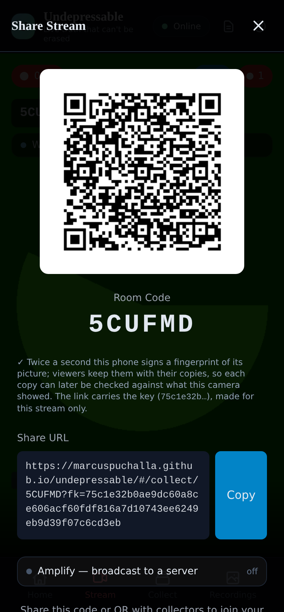
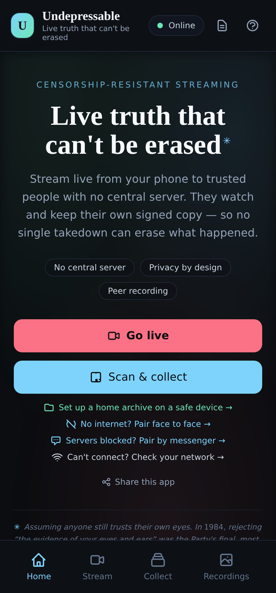
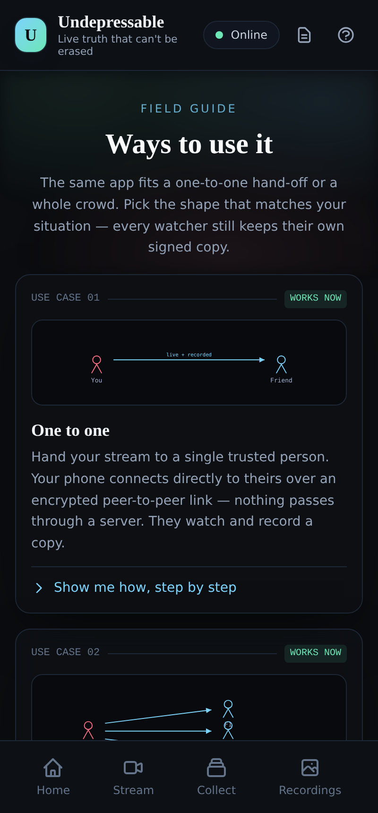
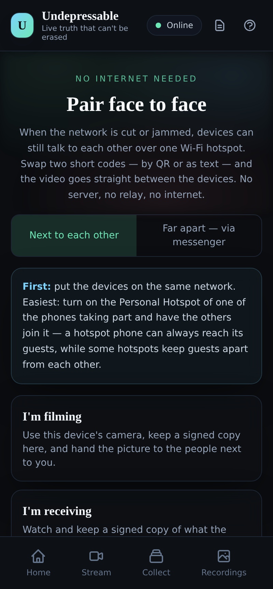
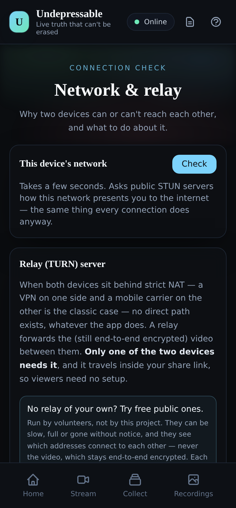

<p align="center">
  
  &nbsp;&nbsp;
  
  &nbsp;&nbsp;
  
</p>

<h1 align="center">Undepressable</h1>

<p align="center">
  <strong>Live video that cannot be stopped by taking the phone, blocking the website, or throttling the network — and whose every copy can prove what it is.</strong>
</p>

<p align="center">
  <a href="https://marcuspuchalla.github.io/undepressable/"><strong>Open the app →</strong></a>
  &nbsp;·&nbsp;
  <a href="https://marcuspuchalla.github.io/undepressable/#/guide">Guide</a>
  &nbsp;·&nbsp;
  <a href="docs/THREAT_MODEL.md">Threat model</a>
  &nbsp;·&nbsp;
  <a href="docs/DEVICE_CHECKLIST.md">What still needs real phones</a>
</p>

<p align="center">
  <a href="https://github.com/marcuspuchalla/undepressable/actions/workflows/pages.yml"></a>
  
  
  
</p>

---

Someone films a protest. The phone is taken. With Undepressable, every person who was watching already holds a **signed copy** of everything up to that second; the filming phone itself may hold **nothing readable**; a home computer may already have it all; and later, anyone with one of those copies can show it is **unaltered**, **signed by a known device**, and — through fingerprints the filming phone signed live — **the picture the camera saw**. Blocking the website does not stop installed copies, the one-file app that passes from phone to phone, or the browser extension. Blocking the servers that introduce devices does not stop two codes over a messenger, or two phones on one hotspot. Throttling the network degrades the picture down to sound before it stops anything.

It is a web app: nothing to install for a viewer, no account for anyone, no server that sees the video.

## Try it in two minutes

1. Open **https://marcuspuchalla.github.io/undepressable/** on a phone and tap **Stream**. A room code and QR code appear.
2. On another device, open the same site, tap **Collect**, and scan the code (or open the share link). The picture arrives; both devices are recording.
3. On the viewer: **Recordings** → the copy is there with its signature, the filmer's signed moments, and a *Send* button that makes an evidence bundle.
4. Unzip a bundle anywhere and double-click **verify.html**: the recording checks itself, with no website and no app.

Two phones on different networks usually connect directly. A VPN or two mobile carriers can need a relay: the status card says so, and a relay set on the **Network** page travels inside your share links. Nothing works without a camera, so use a phone, or a computer with one.

## Ways to use it

The app's guide walks through twelve situations. In short:

1. **One to one** — hand the stream to one trusted person; they watch and record a signed copy.
2. **One to many** — one code for a group; everyone records; viewers pass the stream on, so the phone's upload stays small however many join.
3. **Your personal hotspot** — friends on your hotspot keep getting the picture when the mobile internet is cut; with no internet at all, pair face to face.
4. **Relay to a safe place** — a friend's phone forwards to a home computer that records; what did not make it home follows later, or as a file.
5. **Off-grid mesh** *(partly now)* — phones on one hotspot pair face to face and share onward in chains; Bluetooth and Wi-Fi Direct need a native app.
6. **When the website is blocked or seized** — the one-file app passes hand to hand and mirrors anywhere; updates must be signed; pair by messenger when discovery is blocked; blend in when WebRTC itself is watched.
7. **Reach everyone: amplify** — any device pushes the stream to a WHIP broadcast server; a viewer abroad can do it for you.
8. **Evidence that holds up** — signed recordings, sealed (encrypted) ones the phone itself cannot open, and timestamps anchored in Bitcoin.
9. **Every copy checks back to the camera** — the phone signs its picture twice a second; any copy can be checked against those signatures later.
10. **When the network is throttled** — smaller picture, then sound only, and back up when it recovers; recording throughout.
11. **Many copies, one record** — copies from several viewers laid on the filmer's clock, played or rendered as one.
12. **Evidence that checks itself** — every bundle carries `verify.html`, which checks it on any computer with no website and no app.

Each one in full, with the step-by-step walkthrough the app shows for iPhone, Android and computer: [docs/USE_CASES.md](docs/USE_CASES.md).

## What it does, by threat

| If they… | Then… |
|---|---|
| **take the phone** | Every viewer holds a signed copy. A paired **home archive** records what the phone watched and later receives what it recorded alone. Recordings can be **sealed**: encrypted while recording, to the home archive's key (the phone cannot open them) and/or a passphrase. |
| **edit the footage** | Each second is hashed; a Merkle root is **signed** by the recording device's anonymous key. One changed byte is caught. Evidence bundles carry the proof, and **verify.html** to check it anywhere. |
| **say it was made later** | **OpenTimestamps** anchors the proof in Bitcoin: `ots verify root.txt.ots` with the standard client. |
| **say the viewer's copy is not what the camera saw** | The filming phone signs a **fingerprint of its picture twice a second**, with a key the share link carries. Every copy keeps them. *Check against the filmer* says, second by second, where a copy matches and where it does not. |
| **block the website** | Installed copies run with the site gone. The **single-file app** runs from disk and from any path (a subfolder, IPFS, anyone's site), and hands itself on by AirDrop or Bluetooth. The **browser extension** is another copy. |
| **seize the domain** | Updates are never installed silently: an installed copy accepts only releases **signed by the developers' key** and warns about anything else. |
| **block the discovery servers** | Your own Nostr relay on 443; or **pair by messenger** — two short codes over Signal or SMS, no server at all. |
| **block the internet** | Phones on one hotspot pair **face to face**; viewers **share onward** in chains; recordings are **handed over** or carried as files. |
| **look for WebRTC itself** | **Blend in**: with a `turns:` relay on 443, the app sends nothing but TLS to port 443 — no STUN, no UDP, discovery over WSS only. What a watcher can still see: [docs/TRAFFIC.md](docs/TRAFFIC.md). |
| **throttle the network** | Each viewer's link is measured all the time and steps down — smaller picture, then **sound only** — and back up when it recovers. The viewer keeps recording throughout. |
| **drop a viewer mid-stream** | Copies of one stream from different viewers are laid on the filmer's clock (**Combine copies**): together they cover more than any single one, and render into one signed video that still checks out against the filmer. |
| **need the whole world to see it** | **Amplify** pushes the stream to any WHIP broadcast server — from the filmer, or from a viewer abroad where the server is reachable. |

Every line above is verified end to end in Chromium, with the network conditions simulated (strict NAT, policers, dead discovery, stand-in calendars and broadcast servers). What that cannot prove — real phones, real carriers, real messengers — is listed line by line in [docs/DEVICE_CHECKLIST.md](docs/DEVICE_CHECKLIST.md).

<p align="center">
  
  &nbsp;&nbsp;
  
</p>

## How it works

```
   filming phone ──WebRTC──▶ direct viewers ──WebRTC──▶ further viewers        relay tree: the phone
         │                        │                          │                  uploads a few copies,
      records                  record                     record                viewers pass them on
         │                        │                          │
         └─ signs a fingerprint of its picture, twice a second ──▶ kept with every copy

   discovery   Nostr relays · BitTorrent trackers · MQTT brokers · your own relay · two codes over a
               messenger · face to face on a hotspot
   media       direct, or through a TURN relay (turns: on 443 to blend in); DTLS-SRTP everywhere
   evidence    1-second chunks → SHA-256 → Merkle root → Ed25519; AES-256-GCM sealing to X25519 keys;
               OpenTimestamps; perceptual fingerprints (dHash + aHash) signed live
   copies      home archive (store and forward) · hand-over · evidence bundles (video + proof + verify.html)
```

Vue 3, TypeScript, Vite. [Trystero](https://github.com/dmotz/trystero) for serverless discovery, WebRTC for media, OPFS for storage, `@noble` and WebCrypto for the cryptography. No backend of any kind; an optional TURN relay is the one server you may run ([docs/SELF_HOSTING.md](docs/SELF_HOSTING.md)).

## Verified

| | |
|---|---|
| **Unit tests** | 418 — integrity, Merkle proofs, counts, relay tree, ICE and NAT handling, diagnosis, pairing codes, evidence transfer, releases, WHIP, sealing, timestamps, fingerprints and matching, link ladder, combining, blend-in, the relay panel's advice |
| **End to end, in Chromium** | 34 scenarios in one run: direct and relayed connections, strict NAT, a rejected relay, public relays and the relay panel, six viewers, discovery dying mid-stream, face-to-face pairing and chains, pairing by messenger (also 90 s late), home archive and sync, evidence files, hand-over, Amplify, sealed recordings three ways, timestamps, corroboration three ways, a throttled link (policed to 320 and 56 kbit/s), combined records, blend in (every UDP packet counted: zero), self-checking bundles |
| **Standalone** | Offline install with the server gone; the single-file app from disk and from an arbitrary mirror path; signed updates accepted, unsigned refused; the extension streaming to the web app |
| **Supply chain** | The published `undepressable.html` and `verify.html` are byte-identical to a clean build of the same commit |
| **Against the live site** | The same suite against the published build on GitHub Pages: 32 of 33 scenarios pass (`public-relay` has no live variant). The run found one bug only the published build had — a second share link opened in place did not change the room — fixed and re-tested on the redeployed site. Discovery stayed on a local relay because the test sandbox cannot carry WebSockets to the public relays: that last step is the first line of the device checklist ([part 8 →](docs/RELIABILITY_AUDIT_3.md#part-8--against-the-live-site)) |

The audits ([round 3 →](docs/RELIABILITY_AUDIT_3.md)) record every finding, what was wrong, what changed, and what each test proves.

## Run it yourself

```bash
npm ci
npm run dev                 # http://localhost:4400 — the camera needs localhost or HTTPS
npm run test:unit
npm run build               # dist/ (PWA), the single-file app, verify.html, release.json
sudo node scripts/e2e/scenarios.mjs       # the end-to-end scenarios (root: it simulates NATs with iptables)
sudo LIVE=1 node scripts/e2e/scenarios.mjs  # the same, against the published site
```

Phones need HTTPS: use the published site or an HTTPS tunnel to the dev server ([docs/ON_DEVICE_TESTING.md](docs/ON_DEVICE_TESTING.md)). Every push to `main` publishes the single-file build to GitHub Pages ([.github/workflows/pages.yml](.github/workflows/pages.yml)).

## Before you rely on it

- Read [docs/THREAT_MODEL.md](docs/THREAT_MODEL.md): what it resists, and what it does not. Sealing is off by default. Signed releases are built but **no developer key is compiled in yet**. The app does no traffic obfuscation beyond TLS on 443.
- Two strict networks (a VPN exit, a mobile carrier) cannot connect without a relay. The published site carries one only if whoever publishes it adds it ([docs/SELF_HOSTING.md](docs/SELF_HOSTING.md), "A relay for the published site"); the free public relays the app can test are volunteer-run and often gone.
- Participants see each other's addresses unless everything goes through a relay. A broadcast server sees what it is sent.
- A match against the filmer means the same picture, not the same bytes; whose key it is has to be known from the link the filmer shared.
- Nothing here has been through an external security review.

## Documentation

| | |
|---|---|
| [docs/USE_CASES.md](docs/USE_CASES.md) | The twelve ways to use it, with every step, as the app's guide shows them |
| [docs/PROJECT_PLAN.md](docs/PROJECT_PLAN.md) | Where it came from, what each phase became, metrics against targets, what is next |
| [docs/THREAT_MODEL.md](docs/THREAT_MODEL.md) · [docs/TRAFFIC.md](docs/TRAFFIC.md) | Who can do what, and what the traffic looks like on the wire |
| [docs/STUN_RESEARCH.md](docs/STUN_RESEARCH.md) | Public STUN servers in 2026, the alternatives to using any, and what only a relay solves |
| [docs/TEST_PLAN.md](docs/TEST_PLAN.md) · [docs/DEVICE_CHECKLIST.md](docs/DEVICE_CHECKLIST.md) | Every scenario, how it is checked, what still needs real devices |
| [docs/RELIABILITY_AUDIT_3.md](docs/RELIABILITY_AUDIT_3.md) | The findings and fixes of rounds 3–8, with results |
| [docs/SELF_HOSTING.md](docs/SELF_HOSTING.md) · [docs/STANDALONE.md](docs/STANDALONE.md) | A relay and a discovery relay of your own; the single-file app and mirrors |
| [docs/NATIVE_MESH.md](docs/NATIVE_MESH.md) · [docs/ANDROID_FDROID.md](docs/ANDROID_FDROID.md) · [docs/IOS_CAPACITOR.md](docs/IOS_CAPACITOR.md) | Where a web page ends: radio meshing needs a native app |
| [docs/RELAY_TREE_DESIGN.md](docs/RELAY_TREE_DESIGN.md) · [docs/DECISIONS.md](docs/DECISIONS.md) | Design notes |

## Status

Working, tested in simulation, published — and not yet carried through a protest. If you can test it on real phones and real networks, [docs/DEVICE_CHECKLIST.md](docs/DEVICE_CHECKLIST.md) says exactly what to try and what counts as a pass; please open an issue with what you find. The repository does not carry a license file yet.
